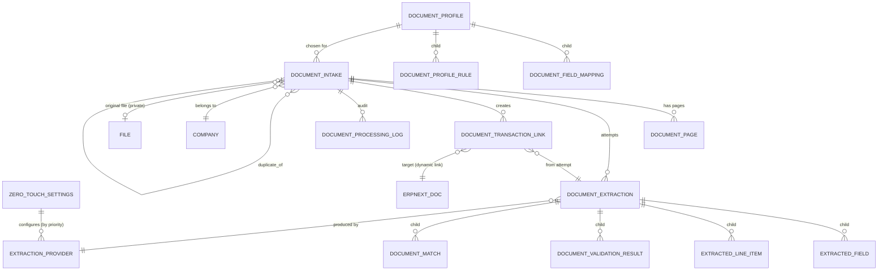

# 02. Final DocType Design and Relationships

> **Current implementation:** Document Profile was merged into **Document Field Mapping**. The scanner also adds a standalone **Document Scan** record, described in section 3.10.
> One mapping record is the document type: its label, target DocType, company and field rows.
> The Document Profile references below are historical.

## 1. Review of the proposed list (17 items)

| Proposed | Decision | Reason |
|----------|----------|--------|
| 1 Zero Touch Settings | **Keep** (Single) | Global switches, AI off by default, limits |
| 2 Document Type Configuration | **Merge** into Document Profile | One record per target type is enough |
| 3 Extraction Provider | **Keep** | Several providers per site, with secrets |
| 4 Field Mapping Template | **Merge** as child table of Document Profile | Mappings have no independent life |
| 5 Validation Rule | **Replace** with code registry plus Document Profile Rule child | Rules are code (tested). Config only enables, sets severity and params |
| 6 Approval Policy | **Defer** to Phase 4 | Not needed for draft-only MVP |
| 7 Document Intake | **Keep** | Central record |
| 8 Document Page | **Keep** (standalone) | Large OCR text must not load with the intake |
| 9 Document Extraction | **Keep** | One per attempt, keeps history for retries |
| 10 Extracted Field | **Keep as child table** of Document Extraction | Bounded per extraction. Avoids thousands of standalone rows |
| 11 Document Processing Run | **Merge** into Document Processing Log and Document Extraction | A stage run is a log event. Extraction attempts cover OCR and AI runs |
| 12 Document Match | **Keep as child table** of Document Extraction | Matches belong to one attempt |
| 13 Document Validation Result | **Keep as child table** of Document Extraction | Same reason |
| 14 Document Review | **Merge**: review state lives on Document Intake, edits in Extracted Field, history in Processing Log | Avoids two sources of truth |
| 15 Document Transaction Link | **Keep** | One intake can create several ERPNext docs. Idempotency key lives here |
| 16 Document Approval | **Defer** to Phase 4 | With approval policies |
| 17 Document Processing Log | **Keep** | Append-only audit |

Added to the list (needed by the design):
- **Document Field Mapping** (child of Document Profile)
- **Document Profile Rule** (child of Document Profile)
- **Extracted Line Item** (child of Document Extraction)

The planned financial intake model is separate from the implemented standalone scanner. The DocType count above is historical design scope, not a count of all current app DocTypes.

Rejected: a separate Document Review DocType. The review is a state of the intake, not a separate object.

## 2. Relationship diagram

## 3. DocType specifications

Naming: all names are prefixed by function, not vendor. Module: `Zero Touch`. Every DocType must have `track_changes` for the business records, and a permission matrix (doc 07).

### 3.1 Zero Touch Settings (Single)

| Field | Type | Default | Notes |
|-------|------|---------|-------|
| enabled | Check | 0 | Global kill switch |
| ai_enabled | Check | 0 | AI off until configured |
| privacy_mode | Select | `local_only` | `local_only` / `minimal_external` / `external_allowed` |
| max_file_size_mb | Int | 20 | Must be at most the Frappe `max_file_size` |
| max_pages | Int | 50 | Multi-page limit |
| allowed_extensions | Small Text | `pdf,jpg,jpeg,png,tiff,csv,xlsx,docx` | Phase 1 subset; see doc 07 |
| retention_days_originals | Int | 0 | 0 = keep forever (decision D-10) |
| retention_days_ai_payloads | Int | 30 | Raw provider payloads |
| max_attempts | Int | 5 | Retry ceiling |
| auto_create_enabled | Check | 0 | Phase 3 switch. Off by default |

The current Settings DocType also includes the VAT tax account and retry delay fields. `max_pages` defaults to 50 and is used by both intake and scanner PDF extraction.

### 3.10 Document Scan (standalone extraction utility)

This record is not part of the Document Intake pipeline and has no Company or ERPNext transaction link.

| Field | Type | Purpose |
|-------|------|---------|
| original_filename | Data | Display name of the private source file |
| source_type | Select (`Document`, `Audio`) | Selects image/PDF extraction or audio transcription |
| audio_language | Data | Required Whisper language code for audio input |
| original_file | Attach | Private Frappe File, linked to this record |
| uploaded_by | Link User | Owner of the scan |
| extracted_text | Long Text | Extracted or transcribed text; kept separate from translation |
| translation_language | Data | Selected target language code |
| translated_text | Long Text | Independent translation output |

Access is owner-scoped for uploaders; reviewers can read, and manager/admin roles can read and write according to the DocType permission table. The UI permits editing extracted text for translation. The API persists those edits with the translation result.

### 3.2 Extraction Provider

| Field | Type | Notes |
|-------|------|-------|
| provider_code | Data, unique | e.g. `text_layer_pdf`, `tesseract_local`, `ollama_local`, `openai_cloud` |
| provider_type | Select | `text_layer`, `ocr`, `classifier`, `llm` |
| enabled | Check | 0 by default |
| priority | Int | Lower runs first |
| engine | Select | Registered implementation name (no free-form code) |
| base_url | Data | Validated by SSRF guard (doc 07). Empty for local engines |
| api_key | Password | Encrypted by Frappe |
| model_name | Data | e.g. `gpt-...`, `llama3.1:8b` |
| timeout_seconds | Int | Per call |
| data_residency | Select | `local`, `external` |
| languages | Data | OCR languages, e.g. `eng+ara` |
| max_pages | Int | Provider-level limit |
| capabilities | Small Text (read-only) | Filled by the engine on registration |

### 3.3 Document Profile

Represents one chosen document type (for example Invoice or Purchase).

| Field | Type | Notes |
|-------|------|-------|
| profile_code | Data, unique | `supplier_invoice`, `purchase_order` (MVP) |
| label | Data | Shown in the upload dialog |
| enabled | Check | |
| target_doctype | Link DocType | Must be in the registry allowlist |
| schema_code | Select (registry) | `supplier_invoice_v1` |
| schema_version | Data (read-only) | For reproducibility |
| mapping_version | Int | Incremented on each change |
| company | Link Company | Optional. Blank = any company the user may access |
| extraction_providers | Table MultiSelect | Ordered chain |
| matching_policy | Select | `none`, `two_way`, `three_way` (phase 4) |
| review_required_fields | Small Text | Field keys always shown for review |
| auto_threshold | Percent | Used only by the Phase 3 policy |
| review_threshold | Percent | Below this, field needs review |
| mapping | Table: Document Field Mapping | |
| rules | Table: Document Profile Rule | |

Child **Document Field Mapping**: `source_key` (Data), `target_field` (Data, must exist in target DocType meta), `target_table` (Data, optional child table), `transform` (Select from registry), `default_value` (Data), `required` (Check), `when` (Small Text, restricted expression grammar, see doc 06).

Child **Document Profile Rule**: `rule_code` (Select from registry), `enabled` (Check), `severity` (Select: `block`, `review`, `warn`), `params` (Small Text, JSON, schema-checked).

Rule: `severity=block` cannot be turned into `warn` for financial rules. The controller enforces this.

### 3.4 Document Intake (main record)

| Field | Type | Notes |
|-------|------|-------|
| naming | `DI-.YYYY.-.#####` | |
| company | Link Company | Required. Permission-checked |
| document_profile | Link Document Profile | Required at upload |
| target_doctype | Data (fetch from profile, read-only) | |
| original_file | Attach (private) | Never public |
| original_filename | Data | Sanitized |
| file_sha256 | Data, indexed | Exact duplicate key |
| file_size | Int | Bytes |
| mime_type | Data | Detected from signature, not extension |
| page_count | Int | |
| channel | Select | `upload`, `drag_drop`, `email` (P4), `api` (P4), `webhook` (P4), `erp_attachment`, `external_storage` (P4) |
| source_reference | Data | Email message ID, API client, attachment name |
| status | Select, indexed | State machine (doc 03) |
| stage | Select | Last completed checkpoint: `none`, `classified`, `extracted`, `validated`, `matched` |
| status_reason | Small Text | Redacted |
| duplicate_of | Link Document Intake | |
| current_extraction | Link Document Extraction | Latest attempt |
| attempt_count | Int | |
| retry_count | Int | |
| next_retry_at | Datetime, indexed | For scheduled retries |
| lock_token | Data | Processing lock (compare-and-set) |
| lock_expires_at | Datetime | Stale lock recovery |
| assigned_to | Link User | Reviewer |
| submitted_by | Link User | Uploader |
| reviewed_by / reviewed_at | Link / Datetime | Last save |
| review_saved | Check | Set by Save Review. Cleared by any later edit. Required for Ready to Create |
| transaction_doctype / transaction_name | Data (dynamic link) | Convenience; authoritative list is Document Transaction Link |

Indexes: `(company, status)`, `(company, file_sha256)`, `(status, next_retry_at)`, `(assigned_to, status)`.

Permissions: a user with access to the intake does **not** automatically get access to the created ERPNext document. See doc 07.

### 3.5 Document Page (standalone)

| Field | Type | Notes |
|-------|------|-------|
| intake | Link Document Intake, indexed | |
| page_no | Int | 1-based |
| width_px / height_px | Int | |
| preview_file | Attach (private) | PNG preview for the review UI |
| text_layer | Long Text | Text from PDF text layer, if any |
| ocr_text | Long Text | Only when OCR ran |
| text_source | Select | `text_layer`, `ocr`, `none` |
| language | Data | Detected (`ar`, `en`, mixed) |
| quality_score | Percent | Image quality heuristic |

Unique: `(intake, page_no)`.

### 3.6 Document Extraction (one per attempt)

| Field | Type | Notes |
|-------|------|-------|
| intake | Link, indexed | |
| attempt_no | Int | Unique with intake |
| document_profile / profile_version / schema_version | Link / Int / Data | Reproducibility |
| status | Select | `running`, `succeeded`, `failed`, `superseded` |
| providers_used | Small Text | Ordered list, e.g. `text_layer_pdf>tesseract_local` |
| model_name / prompt_version | Data | AI runs only |
| input_tokens / output_tokens | Int | When available |
| document_confidence | Percent | Computed from field-level data (doc 04) |
| raw_result_file | Attach (private) | Full provider JSON. Subject to retention |
| started_at / finished_at | Datetime | |
| error_code / error_message | Data / Small Text | Redacted |
| Child tables | Extracted Field, Extracted Line Item, Document Validation Result, Document Match | |

### 3.7 Extracted Field (child of Document Extraction)

| Field | Type | Notes |
|-------|------|-------|
| field_key | Data | e.g. `invoice_number`, `supplier_tax_id` |
| label | Data | |
| value_type | Select | `text`, `date`, `money`, `number`, `percent`, `currency_code`, `identifier` |
| extracted_value | Text | Immutable after extraction. Normalized string form |
| reviewed_value | Text | Editable. Null until user edits. Effective value = reviewed ?? extracted |
| state | Select | `extracted`, `missing`, `uncertain`, `conflict` |
| confidence | Percent | Field-level |
| page_no | Int | |
| bbox | Small Text | Normalized `[x0,y0,x1,y1]` JSON. Null when unsupported |
| source_text | Small Text | Original text |
| provider_code | Data | |
| validation_status | Select | `passed`, `warning`, `failed`, `not_checked` |
| is_low_confidence | Check | Computed against profile threshold |

Note: `Text` (not `Data`) is used for values to avoid the 140-character `Data` limit.

### 3.8 Extracted Line Item (child of Document Extraction)

| Field | Type | Notes |
|-------|------|-------|
| line_no | Int | |
| description | Text | |
| supplier_part_no | Data | |
| qty | Float (9 decimals) | Signed. Negative needs review |
| uom | Data | Raw. Normalized UOM is in `uom_normalized` |
| unit_price | Currency | Stored as Decimal string in `unit_price_text` for precision |
| discount_amount | Currency | |
| tax_rate | Percent | |
| tax_amount | Currency | |
| line_total | Currency | |
| po_reference | Data | |
| page_no / bbox | Int / Small Text | |
| item_code | Link Item | Set only by a confirmed match |
| match_status | Select | `none`, `suggested`, `confirmed` |
| reviewed_json | Long Text | Edited values when the user changes the row. Null = extracted values |
| extracted_json | Long Text | Immutable snapshot |

Phase 2 note: the Decimal-string columns protect money precision. Floats are used only for quantities. Verify Currency field precision behaviour in the Phase 2 spike.

### 3.9 Document Validation Result (child of Document Extraction)

| Field | Type |
|-------|------|
| rule_code | Data |
| severity | Select: `block`, `review`, `warn`, `info` |
| status | Select: `passed`, `failed`, `skipped` |
| field_key / line_no | Data / Int |
| message | Small Text (redacted) |
| expected / actual | Data |

Rows are replaced on every validation run for the same extraction. Run history lives in the Processing Log.

### 3.10 Document Match (child of Document Extraction)

| Field | Type |
|-------|------|
| match_type | Select: `supplier`, `item`, `purchase_order`, `purchase_receipt` |
| source_key | Data (e.g. `line:3` or `supplier_tax_id`) |
| candidate_doctype / candidate_name | Link (dynamic) |
| method | Select: `exact_tax_id`, `exact_name`, `supplier_part_no`, `po_reference`, `fuzzy_name`, `item_code_text`, `ai_suggested` |
| score | Percent |
| status | Select: `suggested`, `confirmed`, `rejected` |
| confirmed_by / confirmed_at | Link / Datetime |

Rule: only deterministic methods can auto-confirm. `fuzzy_name` and `ai_suggested` always start as `suggested`.

### 3.11 Document Transaction Link

| Field | Type | Notes |
|-------|------|-------|
| intake | Link, indexed | |
| extraction | Link | The attempt used |
| target_doctype | Link DocType | |
| target_name | Dynamic Link | |
| creation_key | Data, **unique** | SHA-256 of (intake, extraction, target_doctype, profile_version) |
| status | Select | `created`, `cancelled_in_erpnext` (informational, synced later) |
| created_by | Link User | The acting user |
| created_at | Datetime | |

### 3.12 Document Processing Log (append-only)

| Field | Type | Notes |
|-------|------|-------|
| intake | Link, indexed | Nullable for rejected uploads |
| extraction | Link | |
| event_type | Select | `transition`, `stage_start`, `stage_end`, `stage_fail`, `retry_scheduled`, `correction`, `validation_run`, `match_confirmed`, `create_attempt`, `create_success`, `create_fail`, `access_denied`, `upload_rejected`, `lock_recovered` |
| stage | Data | |
| from_status / to_status | Data | |
| field_key / old_value / new_value | Data / Text / Text | Corrections only. Redacted for sensitive fields |
| actor | Link User | `Administrator` or system user for jobs |
| job_id | Data | |
| provider_code | Data | |
| duration_ms | Int | |
| message | Small Text | Redacted |

Controller: no update or delete allowed, except through the retention purge job, which writes its own event.

## 4. Naming, autonames, and indexes

- Standalone DocTypes use `autoname` = `format:...` or `hash`, not user-visible names, except Document Profile (`profile_code`) and Extraction Provider (`provider_code`).
- Every foreign key used in list filters has an index: intake `company`, `status`, `file_sha256`, `assigned_to`, `next_retry_at`; page `intake`; extraction `intake`; log `intake`, `creation`.
- No child table is queried directly; always query the parent.

## 5. Things we will not create

- A separate table for each OCR word or token. Word-level boxes stay in the raw JSON file.
- A DocType per field type or per rule.
- Any custom table for ERPNext data. We read ERPNext tables through `frappe.get_list`.

## 6. Changes to ERPNext

One Custom Field is proposed for traceability: `zero_touch_intake` (Link Document Intake, indexed, read-only) on Purchase Invoice and Purchase Order. It is added through this app's fixtures, not by editing ERPNext files. Decision D-11 in doc 10.
