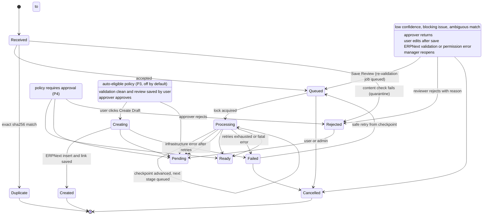

# 03. Document Processing State Machine

## 1. Design decision: status vs stage

The initial list (Received, Queued, Processing, Classified, Extracted, Validating, Matching, ...) mixes two things:
- **Status**: what the business needs next (waiting for a human, ready, done).
- **Stage**: which processing step finished last.

This design splits them:

- `status` (16 values, see below) drives the UI, permissions, and queues.
- `stage` (checkpoint) records the last completed step: `none -> classified -> extracted -> validated -> matched`.

Stages are checkpoints, not statuses. A retry resumes from the last checkpoint, and stage outputs are kept. This keeps the status machine small and makes retries cheap.

Decision D-05 in doc 10 asks you to approve this split.

## 2. Statuses

| Status | Meaning | Terminal |
|--------|---------|----------|
| Received | Upload accepted and stored. Not yet queued | No |
| Queued | Stage job is waiting in a queue | No |
| Processing | A stage job holds the lock | No |
| Pending Review | Human must check or correct fields, or resolve a match | No |
| Pending Approval | Policy requires an approver (Phase 4) | No |
| Ready to Create | Reviewed (or auto-eligible) and waiting for creation | No |
| Creating | Creation job holds the lock and is writing to ERPNext | No |
| Created | ERPNext draft created and linked | Yes |
| Failed | Retries exhausted or non-retryable infrastructure error | No (can retry) |
| Rejected | Refused by a reviewer or by a policy, with reason | No (can reopen) |
| Duplicate | Exact duplicate of an existing intake or existing ERPNext transaction | Yes |
| Cancelled | Withdrawn by a user or admin | Yes |

Phase 1 uses: Received, Queued, Processing, Failed, Rejected, Duplicate, Cancelled, Created (test only). Phase 2 adds Pending Review, Ready to Create, Creating, Created. Phase 4 adds Pending Approval.

## 3. Diagram

## 4. Transition table

Every transition goes through one function, `transition(intake, to_status, actor, reason, expected_from)`. It must:

1. Check the `(from, to)` pair against the allowed table below. Reject anything else.
2. Check the guard for that pair.
3. Perform a compare-and-set update: `UPDATE ... SET status=to WHERE name=... AND status=expected_from`. If zero rows changed, another actor moved the intake. Raise `StaleTransition`, log it, and do not retry blindly.
4. Write a `transition` entry to the Processing Log in the same database transaction.

| From | To | Trigger | Guard | Actor |
|------|----|---------|-------|-------|
| Received | Queued | Upload accepted | File checks passed. Fingerprint computed. No exact duplicate | System |
| Received | Duplicate | Upload | Same `file_sha256` in same company, not Cancelled or Rejected. Sets `duplicate_of` | System |
| Received | Rejected | Content check | Quarantine check failed (malware scan, decompression limit) | System |
| Queued | Processing | Job starts | Lock acquired: `lock_token` set via compare-and-set, or previous lock expired | Job |
| Queued | Cancelled | User | User has write permission on intake | User |
| Processing | Processing | Stage done | `stage` advanced; next stage job enqueued with deterministic job ID | Job |
| Processing | Pending Review | Stage done | Any blocking or review condition (see section 5) | Job |
| Processing | Pending Approval | Stage done | Policy requires approval (P4) | Job |
| Processing | Ready to Create | Stage done | Auto policy enabled and eligible (P3) | Job |
| Processing | Failed | Stage error | Retries exhausted or non-retryable error | Job |
| Pending Review | Queued | Save Review | Edits saved, `review_saved` set, re-validation job queued. Nothing is written to ERPNext | User (with read on intake and write on the review) |
| Processing | Ready to Create | Validation job completes | `review_saved` = 1 for the current extraction, no `block` failures, no unresolved required match | Job |
| Processing | Pending Review | Validation job completes | Any `block` failure or unresolved required match. `review_saved` is cleared | Job |
| Pending Review | Rejected | Reject | Reason is mandatory | User (reviewer role) |
| Pending Review | Cancelled | Cancel | None | User (reviewer role) |
| Pending Approval | Ready to Create | Approve | Approver is not the uploader (segregation of duties) | Approver |
| Pending Approval | Pending Review | Return | Reason mandatory | Approver |
| Pending Approval | Rejected | Reject | Reason mandatory | Approver |
| Ready to Create | Creating | Create Draft | Creation key computed. No existing link with same key. Acting user has create permission on target DocType and read on the intake | User |
| Ready to Create | Pending Review | Edit | Any change to reviewed values after save | User |
| Creating | Created | Insert ok | Transaction link inserted in same DB transaction as ERPNext insert | Job |
| Creating | Pending Review | ERPNext validation or permission error | Rolled back. Error message stored (redacted) | Job |
| Creating | Failed | Infrastructure error | Retries exhausted | Job |
| Failed | Queued | Retry | Resumes from `stage` checkpoint. For `Creating` failures, reconciliation runs first (doc 08) | User or scheduler |
| Failed | Cancelled | Cancel | None | User or admin |
| Rejected | Pending Review | Reopen | Manager role. Reason mandatory | Manager |

Any transition not listed is invalid. Example: `Created -> Creating` is rejected. A Created intake can only be corrected by cancelling the ERPNext document in ERPNext, which is out of scope for the app.

## 5. Decision rules (Phase 2, deterministic, no AI authority)

After the validation and match stages, the job sets the status to **Pending Review** if **any** of these is true:

1. Any extracted field required by the profile has `state` = `missing`, `uncertain`, or `conflict`.
2. Any field has confidence below the profile review threshold.
3. Any validation rule with severity `block` failed. Examples: total mismatch, duplicate, supplier not found.
4. Any match is `suggested` (not confirmed) and needed for creation.
5. The page-level or document-level quality is below the minimum.
6. The file-type check and the profile target disagree (for example a PO uploaded as Invoice).

In MVP (Phase 2), the status is **always** Pending Review after processing. The user must press Save Review. This is the approved default for your flow.

The Phase 3 decision engine adds: auto-eligible if confidence is high, all rules pass, all matches are confirmed deterministically, and `auto_create_enabled` is on. Even then, the output is a **draft**.

Confidence never overrides a failed financial rule or a missing mandatory field. This check is code, not a threshold.

## 6. Invariants

| ID | Invariant | Enforced by |
|----|-----------|-------------|
| I-1 | At most one active job per intake (lock) | `lock_token` compare-and-set + lock expiry |
| I-2 | Status changes only via `transition()` | Controller blocks direct `status` edits (`validate` check) |
| I-3 | Every status change has a log entry | Same DB transaction |
| I-4 | Created requires exactly one link with `creation_key` | Unique index + pre-check |
| I-5 | Created is terminal in this app | Transition table |
| I-6 | Duplicate is terminal | Transition table |
| I-7 | No ERPNext write outside `Creating` | Creation service is the only writer |
| I-8 | Retry never creates a second ERPNext document | Creation key + reconciliation (doc 08) |

## 7. Failure and recovery

- **Worker crash mid-stage.** The lock expires (`lock_expires_at`, default 15 minutes for OCR, 5 for validation). A recovery scheduler moves the intake to Failed with `lock_recovered`, then to Queued (retry). The stage restarts from the last checkpoint.
- **Provider outage.** Provider calls have timeouts and retries. After the chain is exhausted for an optional AI provider, the stage completes using deterministic extraction and the intake goes to Pending Review with the reason "AI unavailable". This is not a Failed status. A non-optional OCR outage goes to Failed.
- **ERPNext rejects the draft** (for example a disabled supplier). The intake returns to Pending Review with the message. This is a business issue, not a system failure.
